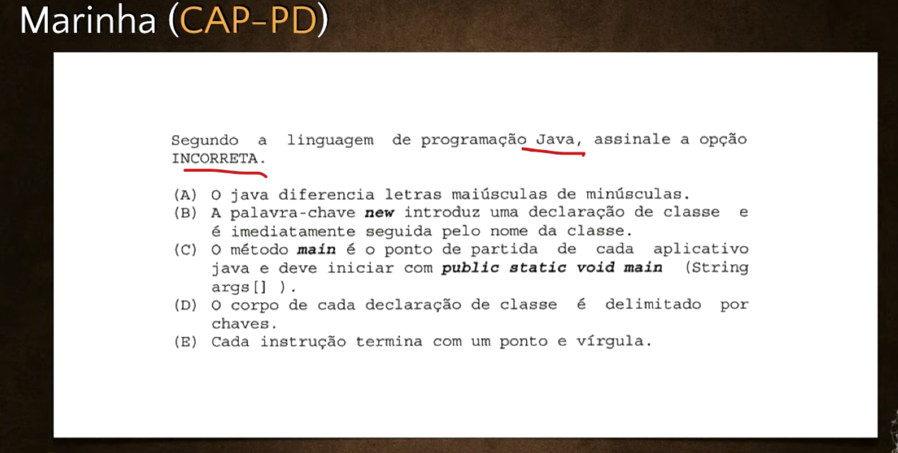
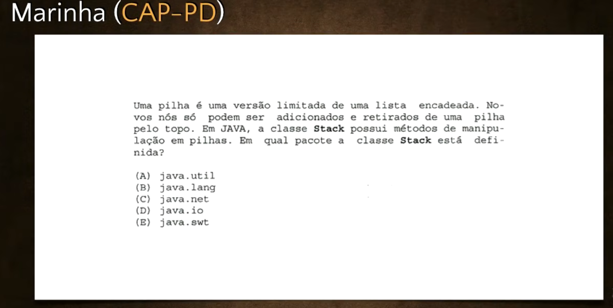
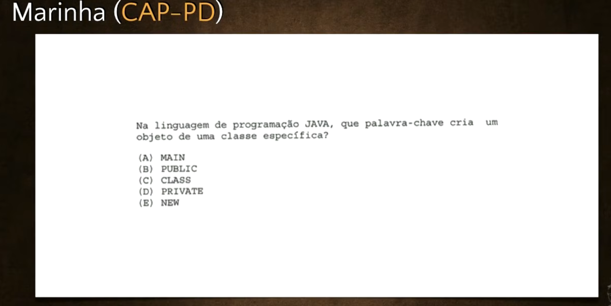

# Exercícios de Java #05 - Curso de Java para Iniciantes
**Professor:** Gustavo Guanabara | **Canal:** Curso em Vídeo

Chegamos à quinta aula de exercícios do curso! Este vídeo é focado em revisar o conteúdo sobre classes, objetos, bibliotecas (pacotes) e importações, com a tradicional resolução de questões de concursos militares (Marinha e Aeronáutica). Além disso, temos a **segunda prática de código real em Java** no NetBeans, onde recriaremos o Relógio do Sistema utilizando a biblioteca Swing.

---

## 1. Resolução de Questões de Concurso

O professor faz a resolução de três questões fundamentais sobre a teoria das Classes e Pacotes em Java.

### Questão 1: Características e Palavras-chave do Java
**Pergunta:** Segundo a linguagem de programação Java, assinale a opção INCORRETA.

*   **A) O Java diferencia letras maiúsculas e minúsculas.** (Correto - Java é Case Sensitive).
*   **B) A palavra-chave `new` introduz a declaração de classe e é imediatamente seguida pelo nome da classe.** (INCORRETO - A palavra que introduz uma classe é `class`. A palavra `new` cria um *novo objeto*).
*   **C) O método `main` é o ponto de partida de cada aplicativo Java...** (Correto - `public static void main(String[] args)` ou `String args[]`).
*   **D) O corpo de cada declaração de classe é delimitado por chaves `{ }`.** (Correto).
*   **E) Cada instrução termina com um ponto e vírgula `;`.** (Correto).
*   **Análise:** A pegadinha está na Letra B. O comando `new` serve estritamente para instanciar (criar) um objeto, e não para declarar uma classe. 
*   **Resposta Certa:** B (Alternativa Incorreta).



### Questão 2: Importação de Bibliotecas / Pacotes
**Pergunta:** Uma pilha é uma versão limitada de uma lista encadeada. Novos nós só podem ser adicionados e retirados pelo topo. Em Java, a classe `Stack` possui métodos de manipulação de pilhas. Em qual pacote a classe `Stack` está definida?

*   **Análise:** 
    *   No Java, as classes utilitárias (como manipulação de datas com `Date` e estruturas de dados como pilhas/filas com `Stack`) ficam guardadas dentro do pacote de **Utilitários**.
    *   O pacote de utilitários no Java é chamado de `java.util`.
    *   *Nota Extra do Professor:* A alternativa `java.lang` é a biblioteca padrão nativa do Java, que é carregada automaticamente em todo projeto e não precisa do comando `import`.
*   **Resposta Certa:** A (`java.util`).



### Questão 3: Criação de Objetos
**Pergunta:** Na linguagem de programação Java, qual palavra-chave cria um objeto de uma classe específica?


*   **Análise:** Como já visto na Questão 1 e reforçado na aula teórica, sempre que queremos criar (instanciar) um novo objeto a partir de uma classe no Java, utilizamos a palavra reservada `new`. 
*   **Resposta Certa:** A (`new`).


---

## 2. A Prática no NetBeans: Relógio com Swing + Imagens

Após a revisão de lógica, o professor abre o NetBeans para recriar o programa da Aula 04 que descobre a data e hora do sistema, porém agora construindo uma **Janela Gráfica (JFrame) personalizada com Imagens**.

### Passo a Passo da Prática:
1.  **Criar o Projeto e a Tela:**
    *   Criar um Novo Projeto Java chamado `RelogioSwing` (Desmarcar "Criar classe principal").
    *   Criar um pacote chamado `cursoemvideo`. Dentro dele, criar um *Formulário JFrame* chamado `TelaRelogio`.
2.  **Preparar as Imagens:**
    *   Criar um segundo pacote chamado `imagens`.
    *   Para importar uma imagem para a tela: Colocar um `JLabel` vazio na tela. Nas Propriedades do JLabel, ir em `icon` ➔ `Importar para o projeto` ➔ Selecionar uma imagem PNG salva no computador ➔ Escolher como destino o pacote `imagens`. O NetBeans colocará a imagem dentro do projeto e a exibirá na tela.
3.  **Montar a Interface:**
    *   Adicionar um `JLabel` fixo: "Data e Hora Atuais".
    *   Adicionar um `JLabel` para receber o resultado (nome da variável: `lblHora`). Mudar a cor (`foreground`) para cinza e apagar o texto inicial.
    *   Adicionar um `JButton` (nome da variável: `btnHora`) com o texto "Clique Aqui".
4.  **O Código do Evento:**
    *   Clicar com o botão direito no Botão ➔ Eventos ➔ Action ➔ `actionPerformed`.
    *   Escrever a lógica:
        ```java
        // Instancia o objeto da classe Date
        Date relogio = new Date(); // Exigirá importação de java.util.Date
        
        // Joga o resultado do relógio convertido para String dentro do texto do JLabel
        lblHora.setText(relogio.toString());
        ```
5.  **Executar:**
    *   Apertar Play. O programa solicitará a Classe Principal (escolher a `TelaRelogio`). Ao clicar no botão da janela, o Java injetará a data e hora da máquina no JLabel cinza!

---

## 3. Os Desafios do Idioma e da Resolução (Versão Gráfica)

Como "dever de casa", o professor demonstra o resultado dos dois desafios passados na semana anterior (Idioma do Sistema e Resolução da Tela), mas agora aplicados também dentro do visual do **Swing**.

A tarefa é pegar as classes `Locale` (para descobrir se o sistema está em Português, Inglês, etc.) e `Toolkit` (para puxar os pixels do monitor, ex: 1280x720) e integrar isso com botões e imagens usando a mesma técnica da prática do Relógio!

---

## 📊 Área de Acompanhamento (Seu Desempenho)

*Use esta seção para registrar quantas questões você acertou na revisão técnica de hoje:*

**Meus Acertos:** `[ 3 / 3 ]`